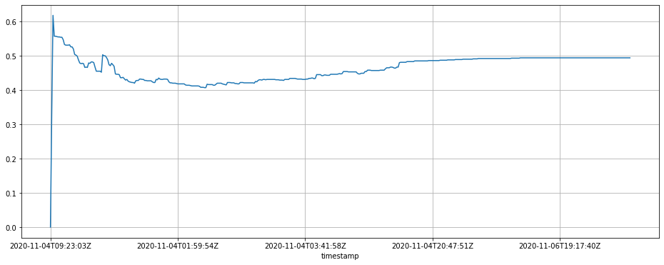

> built 2026-11-21 17:37 UTC from f847be1 (master) · elections 0.0.4. Details: build_info.json

# index.html.md

<!-- generated by epythet -->

# elections

A unified Python interface to multiple election data sources from around the world.

## Overview

The `elections` package provides easy access to various election data APIs through a consistent interface. Whether you need U.S. federal campaign finance data, international parliamentary statistics, or real-time election results, this package offers a simple way to access it all.

## Installation

```bash
pip install elections
```

Note: Some data sources require additional dependencies (pandas, py2store) which will be installed automatically.

## General Interface

The package provides a dictionary-like interface to access different data source modules:

```python
from elections import ElectionsDataModules

# Access all data source modules
modules = ElectionsDataModules()

# List available sources
print(list(modules))
# ['nytimes', 'openfec', 'google_civic', 'democracy_works', 'ipu_parline']
```

### Available Data Sources

- **nytimes**: New York Times election results (2016, 2020, 2024) - No API key required
- **openfec**: Federal Election Commission campaign finance data - Optional API key
- **google_civic**: Google Civic Information API (polling, representatives, voter info) - API key required
- **democracy_works**: Democracy Works election guidance (dates, deadlines, locations) - No API key required
- **ipu_parline**: Inter-Parliamentary Union global parliamentary data - No API key required

## Usage Examples

### OpenFEC - Federal Campaign Finance

Access U.S. federal campaign finance data, including candidates, committees, and contributions:

```python
from elections import ElectionsDataModules

modules = ElectionsDataModules()

# Get OpenFEC module
openfec = modules["openfec"]

# Get 2024 presidential candidates
candidates = openfec.get_candidates(year=2024, office="president")
print(f"Found {len(candidates['results'])} candidates")

# Search for specific candidate
results = openfec.search_candidates("Biden", year=2024)

# Get financial totals for a candidate
totals = openfec.get_candidate_totals("P80001571", year=2020)
```

**API Key:** Optional for higher rate limits. Get a free key at https://api.open.fec.gov/developers/

### Google Civic Information

Get voter information, polling locations, and representatives:

```python
from elections import ElectionsDataModules

modules = ElectionsDataModules()

# Get Google Civic module
civic = modules["google_civic"]

# Get voter information for an address
info = civic.get_voter_info(
    "1600 Pennsylvania Ave NW, Washington, DC", api_key="YOUR_KEY"
)

# Get representatives for an address
reps = civic.get_representatives("340 Main St, Venice, CA 90291", api_key="YOUR_KEY")

# Get list of available elections
elections = civic.get_elections(api_key="YOUR_KEY")
```

**API Key:** Required. Get a free key at https://console.developers.google.com/

### IPU Parline - International Parliamentary Data

Access global parliamentary and election data for 190+ countries:

```python
from elections import ElectionsDataModules

modules = ElectionsDataModules()

# Get IPU Parline module
ipu = modules["ipu_parline"]

# Get parliament information for France
france = ipu.get_parliament("FRA")

# Get election results for Germany
results = ipu.get_election_results("DEU")

# Get women in parliament statistics
stats = ipu.get_women_in_parliament("SWE")

# Get list of all countries
countries = ipu.get_country_list()
```

**API Key:** Not required

### Democracy Works

Get U.S. election dates, deadlines, and voting locations:

```python
from elections import ElectionsDataModules

modules = ElectionsDataModules()

# Get Democracy Works module
dw = modules["democracy_works"]

# Get upcoming elections
upcoming = dw.get_upcoming_elections(region="PA", days_ahead=60)

# Get elections for a specific state
state_elections = dw.get_state_elections("CA")

# Get all elections
elections = dw.get_elections()
```

**API Key:** Not required

### New York Times Election Results

Access historical U.S. election results (2016, 2020, 2024):

```python
from elections import ElectionsDataModules

modules = ElectionsDataModules()

# Get NYT module
nyt = modules["nytimes"]

# Get election data for a state
data = nyt.get_election_data("florida", year=2020)

# Get all races for a state
races = nyt.get_races("pennsylvania", year=2020)

# Get president race time series
timeseries = nyt.get_president_timeseries("georgia", year=2020)
```

**API Key:** Not required

## Direct Module Import

You can also import data source modules directly:

```python
# Import specific modules
from elections import openfec, google_civic, ipu_parline

# Use them directly
candidates = openfec.get_candidates(year=2024, office="president")
info = google_civic.get_voter_info("1600 Pennsylvania Ave", api_key="YOUR_KEY")
france = ipu_parline.get_parliament("FRA")
```

## Consistent Parameter Names

Across all modules, we use consistent parameter names:

- **year**: Election year (e.g., 2020, 2024)
- **region**: Geographic region (state abbreviation like ‘PA’, or state name)
- **api_key**: API authentication key (when required)
- **race_type**: Type of race (e.g., ‘president’, ‘senate’, ‘house’)
- **office**: Office being sought (used by some APIs)

## API Keys Setup

Set API keys via environment variables for convenience:

```bash
export OPENFEC_API_KEY='your_openfec_key'
export GOOGLE_CIVIC_API_KEY='your_google_key'
```

---

# Specific Example: 2020 US elections

Easy access to (US 2020) election statistics.

Yes, you can do it via our general interface, doing:

```python
from elections import ElectionsDataModules

modules = ElectionsDataModules()

nyt = modules["nytimes"]
data = nyt.get_election_data("florida", year=2020)
```

But here’s another convenient dict-like interface that was made based on it.

```python
import pandas as pd
from elections import President2020TimeSeries, Races2020, Election2020RawJson
```

## President’s race stats

```python
from elections import President2020TimeSeries

s = President2020TimeSeries()
len(s)
# Returns: 51
```

`s` is a dictionary-like interface to the presidential race. Its keys are the states:

```python
print(*s)
# alabama alaska arizona arkansas california colorado connecticut delaware
# district-of-columbia florida georgia hawaii idaho illinois indiana iowa kansas
# kentucky louisiana maine maryland massachusetts michigan minnesota mississippi
# missouri montana nebraska nevada new-hampshire new-jersey new-mexico new-york
# north-carolina north-dakota ohio oklahoma oregon pennsylvania rhode-island
# south-carolina south-dakota tennessee texas utah vermont virginia washington
# west-virginia wisconsin wyoming
```

Its values are dataframes containing the stats:

```python
state = "georgia"
df = s[state]
df
```

| timestamp            | votes   | eevp   | eevp_source   | trumpd   | bidenj   |
|----------------------|---------|--------|---------------|----------|----------|
| 2020-11-04T09:23:03Z | 0       | 0      | edison        | 0.000    | 0.000    |
| 2020-11-04T00:14:11Z | 408     | 0      | edison        | 0.674    | 0.326    |
| 2020-11-04T00:15:51Z | 127106  | 2      | edison        | 0.370    | 0.618    |
| 2020-11-04T00:19:55Z | 173638  | 3      | edison        | 0.431    | 0.557    |
| …                    | …       | …      | …             | …        | …        |
| 2020-11-06T23:45:40Z | 4970093 | 99     | edison        | 0.493    | 0.494    |

*456 rows × 5 columns*

```python
df["bidenj"].plot(figsize=(16, 6), grid=True, title=state)
```



## Other races

But that’s not the only race going on here.

```python
from elections import Races2020

s = Races2020()
len(s)
# Returns: 51
```

```python
data = s["new-york"]  # by the way, you can tab-complete this in a jupyter notebook
print(type(data))
# <class 'py2store.base.Store'>

print(f"{len(data)} items... Here are the first 5:")
list(data)[:5]
# ['president-general-2020-11-03',
#  'house-general-district-001-2020-11-03',
#  'house-general-district-002-2020-11-03',
#  'house-general-district-003-2020-11-03',
#  'house-general-district-004-2020-11-03']
```

So we see that now, instead of just getting the president’s race, we get… 242 races (one of which is the president’s race).

What you need to know is that `President2020TimeSeries` just gave you one of the many data fields available for the race (the ‘timeseries’ one), extracted and formatted for your convenience, since it’s probably the main information you’re here for.

But there are other associated (raw) data fields you may or may not be interested in. Here’s what you got:

```python
data[
    "president-general-2020-11-03"
].keys()  # you can tab complete here as well (you're welcome!)
# dict_keys(['race_id', 'race_slug', 'url', 'state_page_url', 'ap_polls_page',
#            'edison_exit_polls_page', 'race_type', 'election_type', 'election_date',
#            'runoff', 'race_name', 'office', 'officeid', 'race_rating', 'seat',
#            'seat_name', 'state_id', 'state_slug', 'state_name', 'state_nyt_abbrev',
#            'state_shape', 'party_id', 'uncontested', 'report', 'result',
#            'result_source', 'gain', 'lost_seat', 'votes', 'electoral_votes',
#            'absentee_votes', 'absentee_counties', 'absentee_count_progress',
#            'absentee_outstanding', 'absentee_max_ballots', 'provisional_outstanding',
#            'provisional_count_progress', 'poll_display', 'poll_countdown_display',
#            'poll_waiting_display', 'poll_time', 'poll_time_short', 'precincts_reporting',
#            'precincts_total', 'reporting_display', 'reporting_value', 'eevp',
#            'tot_exp_vote', 'eevp_source', 'eevp_value', 'eevp_display',
#            'county_data_source', 'incumbent_party', 'no_forecast', 'last_updated',
#            'candidates', 'has_incumbent', 'leader_margin_value', 'leader_margin_votes',
#            'leader_margin_display', 'leader_margin_name_display', 'leader_party_id',
#            'counties', 'votes2016', 'margin2016', 'clinton2016', 'trump2016',
#            'votes2012', 'margin2012', 'expectations_text', 'expectations_text_short',
#            'absentee_ballot_deadline', 'absentee_postmark_deadline', 'update_sentences',
#            'race_diff', 'winnerCalledTimestamp', 'timeseries'])
```

```python
t = data["president-general-2020-11-03"]
print(t["trump2016"], t["clinton2016"])
# 2819534 4556124
```

## Election2020RawJson

But if you want even more raw data than the above, we can give that to you.

With `Election2020RawJson` you get access to the original full JSON.

```python
from elections import Election2020RawJson
import pandas as pd

raw_jsons = Election2020RawJson()
json_data = raw_jsons["california"]

print(json_data.keys())
# dict_keys(['data', 'meta'])

print(json_data["meta"])
# {'version': 10403,
#  'track': '2020-11-03',
#  'timestamp': '2020-11-06T23:52:57.623Z'}

print(json_data["data"].keys())
# dict_keys(['races', 'party_control', 'liveUpdates'])
```

### Party Control

```python
party_df = pd.DataFrame(json_data["data"]["party_control"]).set_index("race_type").T
```

| race_type          | house   | president   | senate                                         |
|--------------------|---------|-------------|------------------------------------------------|
| needed_for_control | 218     | 270         | 50                                             |
| total              | 435     | 538         | 100                                            |
| no_election        | {}      | {}          | {‘democrat’: 35, ‘republican’: 30, ‘other’: 0} |

### Live Updates

```python
updates_df = pd.DataFrame(json_data["data"]["liveUpdates"])
print(f"Total live updates: {len(updates_df)}")
# Total live updates: 449
```

Example entries from the 449 live updates:

|   id | author          | location        | text                                                |
|------|-----------------|-----------------|-----------------------------------------------------|
|  333 | Nate Cohn       | in New York     | New ballots from Clark County (that’s Las Vegas)…   |
|  332 | Nate Cohn       | in New York     | The latest Arizona ballot releases aren’t looking…  |
|  331 | Nick Corasaniti | in Philadelphia | There are still 102,000 mail ballots to be counted… |
|  330 | Dave Philipps   | in Las Vegas    | Biden nets 2,520 votes in the Las Vegas area…       |
<p class="epythet-aggregates">This documentation as a single file: <a href="elections.md">elections.md</a> (Markdown, for agents).</p>


# _autosummary/elections.democracy_works.html.md

# elections.democracy_works

Democracy Works Elections API Data Source

This module provides access to U.S. election guidance data through the Democracy Works
Elections API, including election dates, deadlines, polling locations, ballot measures,
and candidate information for federal, state, and local levels.

**Data Source:** Democracy Works Elections API
**Base URL:** [https://api.democracy.works/elections/v2/](https://api.democracy.works/elections/v2/)
**Access:** Free, no API key required (but may require registration for alerts)
**Coverage:** U.S. federal, state, and local elections
**Data Types:** Election dates, deadlines, polling locations, ballot measures, candidates

**More Information:**

- API Documentation: [https://developers.democracy.works/api/v2](https://developers.democracy.works/api/v2)
- Google Group (for updates): [https://groups.google.com/g/turbovote-api](https://groups.google.com/g/turbovote-api)
- Main Site: [https://www.democracy.works/](https://www.democracy.works/)

**Note:** This API provides voter guidance data including when and where to vote.
It’s particularly useful for getting information about upcoming elections, registration
deadlines, and voting locations.

**Example Usage:**

```pycon
>>> from elections.democracy_works import get_elections, get_election_by_id, get_state_elections
>>>
>>> # Get list of all elections
>>> elections = get_elections()
>>>
>>> # Get elections for a specific state
>>> state_elections = get_state_elections(region='PA')
>>>
>>> # Get detailed info for specific election
>>> election = get_election_by_id('12345')
```

### Functions

| [`get_election_by_id`](_autosummary/elections.democracy_works.html.md#elections.democracy_works.get_election_by_id)(election_id)                   | Get detailed information for a specific election.     |
|----------------------------------------------------------------------------------------------------|-------------------------------------------------------|
| [`get_elections`](_autosummary/elections.democracy_works.html.md#elections.democracy_works.get_elections)([date_from, date_to])               | Get list of elections.                                |
| [`get_state_elections`](_autosummary/elections.democracy_works.html.md#elections.democracy_works.get_state_elections)(region[, date_from, date_to]) | Get elections for a specific state.                   |
| [`get_upcoming_elections`](_autosummary/elections.democracy_works.html.md#elections.democracy_works.get_upcoming_elections)([region, days_ahead])      | Get upcoming elections, optionally filtered by state. |

### elections.democracy_works.get_election_by_id(election_id)

Get detailed information for a specific election.

* **Parameters:**
  **election_id** ([`str`](https://docs.python.org/3/builtins/stdtypes.html#str)) – Election ID (obtained from get_elections())
* **Return type:**
  [`Dict`](https://docs.python.org/3/library/typing.html#typing.Dict)[[`str`](https://docs.python.org/3/builtins/stdtypes.html#str), [`Any`](https://docs.python.org/3/library/typing.html#typing.Any)]
* **Returns:**
  Dictionary with election details

### Example

```pycon
>>> election = get_election_by_id('12345')
>>> 'id' in election
True
```

### elections.democracy_works.get_elections(date_from=None, date_to=None, \*\*kwargs)

Get list of elections.

* **Parameters:**
  * **date_from** ([`Optional`](https://docs.python.org/3/library/typing.html#typing.Optional)[[`str`](https://docs.python.org/3/builtins/stdtypes.html#str)]) – Start date in YYYY-MM-DD format
  * **date_to** ([`Optional`](https://docs.python.org/3/library/typing.html#typing.Optional)[[`str`](https://docs.python.org/3/builtins/stdtypes.html#str)]) – End date in YYYY-MM-DD format
  * **\*\*kwargs** – Additional API parameters
* **Return type:**
  [`Dict`](https://docs.python.org/3/library/typing.html#typing.Dict)[[`str`](https://docs.python.org/3/builtins/stdtypes.html#str), [`Any`](https://docs.python.org/3/library/typing.html#typing.Any)]
* **Returns:**
  Dictionary with elections list

### Example

```pycon
>>> elections = get_elections()
>>> len(elections) > 0
True
```

### elections.democracy_works.get_state_elections(region, date_from=None, date_to=None, \*\*kwargs)

Get elections for a specific state.

* **Parameters:**
  * **region** ([`str`](https://docs.python.org/3/builtins/stdtypes.html#str)) – State abbreviation (e.g., ‘PA’, ‘CA’)
  * **date_from** ([`Optional`](https://docs.python.org/3/library/typing.html#typing.Optional)[[`str`](https://docs.python.org/3/builtins/stdtypes.html#str)]) – Start date in YYYY-MM-DD format
  * **date_to** ([`Optional`](https://docs.python.org/3/library/typing.html#typing.Optional)[[`str`](https://docs.python.org/3/builtins/stdtypes.html#str)]) – End date in YYYY-MM-DD format
  * **\*\*kwargs** – Additional API parameters
* **Return type:**
  [`Dict`](https://docs.python.org/3/library/typing.html#typing.Dict)[[`str`](https://docs.python.org/3/builtins/stdtypes.html#str), [`Any`](https://docs.python.org/3/library/typing.html#typing.Any)]
* **Returns:**
  Dictionary with state elections

### Example

```pycon
>>> elections = get_state_elections('PA')
>>> isinstance(elections, (dict, list))
True
```

### elections.democracy_works.get_upcoming_elections(region=None, days_ahead=90)

Get upcoming elections, optionally filtered by state.

* **Parameters:**
  * **region** ([`Optional`](https://docs.python.org/3/library/typing.html#typing.Optional)[[`str`](https://docs.python.org/3/builtins/stdtypes.html#str)]) – Optional state abbreviation (e.g., ‘PA’, ‘CA’)
  * **days_ahead** ([`int`](https://docs.python.org/3/builtins/functions.html#int)) – Number of days to look ahead (default 90)
* **Return type:**
  [`Dict`](https://docs.python.org/3/library/typing.html#typing.Dict)[[`str`](https://docs.python.org/3/builtins/stdtypes.html#str), [`Any`](https://docs.python.org/3/library/typing.html#typing.Any)]
* **Returns:**
  Dictionary with upcoming elections

### Example

```pycon
>>> elections = get_upcoming_elections(region='CA', days_ahead=60)
>>> isinstance(elections, (dict, list))
True
```


# _autosummary/elections.google_civic.html.md

# elections.google_civic

Google Civic Information API Data Source

This module provides access to U.S. civic data through Google’s Civic Information API,
including elections, representatives, polling places, early voting sites, and candidate
information. The API covers both historical and upcoming elections.

**Data Source:** Google Civic Information API
**Base URL:** [https://civicinfo.googleapis.com/civicinfo/v2/](https://civicinfo.googleapis.com/civicinfo/v2/)
**Access:** Requires free Google API key
**Rate Limits:** 1,000 requests/day (free tier)
**Coverage:** U.S. federal, state, and local elections
**Data Types:** Elections, representatives, polling locations, ballot info, candidates

**Getting an API Key:**

1. Go to: [https://console.developers.google.com/](https://console.developers.google.com/)
2. Create a new project (or select existing)
3. Enable the “Google Civic Information API”
4. Go to “Credentials” and create an API key
5. Set via environment variable: export GOOGLE_CIVIC_API_KEY=’your_key’

**More Information:**

- API Documentation: [https://developers.google.com/civic-information/docs/v2](https://developers.google.com/civic-information/docs/v2)
- API Console: [https://console.developers.google.com/apis/library/civicinfo.googleapis.com](https://console.developers.google.com/apis/library/civicinfo.googleapis.com)
- Data Coverage: [https://developers.google.com/civic-information/docs/v2/coverage](https://developers.google.com/civic-information/docs/v2/coverage)

**Error Messages:**
If you receive an authentication error, you need a Google API key:

1. Register at: [https://console.developers.google.com/](https://console.developers.google.com/)
2. Enable the Civic Information API for your project
3. Create an API key in the Credentials section

**Example Usage:**

```pycon
>>> from elections.google_civic import get_elections, get_voter_info, get_representatives
>>>
>>> # Get list of available elections
>>> elections = get_elections(api_key='YOUR_KEY')
>>>
>>> # Get voter information for an address
>>> voter_info = get_voter_info(
...     address='1600 Pennsylvania Ave NW, Washington, DC',
...     api_key='YOUR_KEY'
... )
>>>
>>> # Get representatives for an address
>>> reps = get_representatives(
...     address='340 Main St, Venice, CA 90291',
...     api_key='YOUR_KEY'
... )
```

### Functions

| [`get_elections`](_autosummary/elections.google_civic.html.md#elections.google_civic.get_elections)([api_key])                     | Get list of available elections.                             |
|-----------------------------------------------------------------------------------------------|--------------------------------------------------------------|
| [`get_representatives`](_autosummary/elections.google_civic.html.md#elections.google_civic.get_representatives)([address, ...])          | Get elected representatives for an address.                  |
| [`get_representatives_by_division`](_autosummary/elections.google_civic.html.md#elections.google_civic.get_representatives_by_division)(division_id) | Get representatives for a specific Open Civic Data division. |
| [`get_voter_info`](_autosummary/elections.google_civic.html.md#elections.google_civic.get_voter_info)(address[, election_id, ...])  | Get voter information for a specific address.                |

### elections.google_civic.get_elections(api_key=None)

Get list of available elections.

Returns information about current and upcoming elections, including election IDs
that can be used with get_voter_info().

* **Parameters:**
  **api_key** ([`Optional`](https://docs.python.org/3/library/typing.html#typing.Optional)[[`str`](https://docs.python.org/3/builtins/stdtypes.html#str)]) – Google Civic Information API key
* **Return type:**
  [`Dict`](https://docs.python.org/3/library/typing.html#typing.Dict)[[`str`](https://docs.python.org/3/builtins/stdtypes.html#str), [`Any`](https://docs.python.org/3/library/typing.html#typing.Any)]
* **Returns:**
  Dictionary with ‘elections’ list containing election details

### Example

```pycon
>>> elections = get_elections(api_key='YOUR_KEY')
>>> len(elections['elections']) > 0
True
>>> elections['elections'][0]['name']
'U.S. General Election'
```

### elections.google_civic.get_representatives(address=None, include_offices=True, levels=None, roles=None, api_key=None)

Get elected representatives for an address.

Returns information about federal, state, and local elected officials.

* **Parameters:**
  * **address** ([`Optional`](https://docs.python.org/3/library/typing.html#typing.Optional)[[`str`](https://docs.python.org/3/builtins/stdtypes.html#str)]) – Full address (if not provided, uses national divisions)
  * **include_offices** ([`bool`](https://docs.python.org/3/builtins/functions.html#bool)) – Whether to include office information
  * **levels** ([`Optional`](https://docs.python.org/3/library/typing.html#typing.Optional)[[`List`](https://docs.python.org/3/library/typing.html#typing.List)[[`str`](https://docs.python.org/3/builtins/stdtypes.html#str)]]) – List of government levels (‘country’, ‘administrativeArea1’, ‘locality’)
  * **roles** ([`Optional`](https://docs.python.org/3/library/typing.html#typing.Optional)[[`List`](https://docs.python.org/3/library/typing.html#typing.List)[[`str`](https://docs.python.org/3/builtins/stdtypes.html#str)]]) – List of roles (‘legislatorUpperBody’, ‘legislatorLowerBody’, ‘headOfGovernment’)
  * **api_key** ([`Optional`](https://docs.python.org/3/library/typing.html#typing.Optional)[[`str`](https://docs.python.org/3/builtins/stdtypes.html#str)]) – Google Civic Information API key
* **Return type:**
  [`Dict`](https://docs.python.org/3/library/typing.html#typing.Dict)[[`str`](https://docs.python.org/3/builtins/stdtypes.html#str), [`Any`](https://docs.python.org/3/library/typing.html#typing.Any)]
* **Returns:**
  Dictionary with divisions, offices, and officials

### Example

```pycon
>>> reps = get_representatives(
...     '340 Main St, Venice, CA 90291',
...     api_key='YOUR_KEY'
... )
>>> 'officials' in reps
True
```

### elections.google_civic.get_representatives_by_division(division_id, levels=None, roles=None, api_key=None)

Get representatives for a specific Open Civic Data division.

* **Parameters:**
  * **division_id** ([`str`](https://docs.python.org/3/builtins/stdtypes.html#str)) – OCD division ID (e.g., ‘ocd-division/country:us/state:ca’)
  * **levels** ([`Optional`](https://docs.python.org/3/library/typing.html#typing.Optional)[[`List`](https://docs.python.org/3/library/typing.html#typing.List)[[`str`](https://docs.python.org/3/builtins/stdtypes.html#str)]]) – List of government levels to filter
  * **roles** ([`Optional`](https://docs.python.org/3/library/typing.html#typing.Optional)[[`List`](https://docs.python.org/3/library/typing.html#typing.List)[[`str`](https://docs.python.org/3/builtins/stdtypes.html#str)]]) – List of roles to filter
  * **api_key** ([`Optional`](https://docs.python.org/3/library/typing.html#typing.Optional)[[`str`](https://docs.python.org/3/builtins/stdtypes.html#str)]) – Google Civic Information API key
* **Return type:**
  [`Dict`](https://docs.python.org/3/library/typing.html#typing.Dict)[[`str`](https://docs.python.org/3/builtins/stdtypes.html#str), [`Any`](https://docs.python.org/3/library/typing.html#typing.Any)]
* **Returns:**
  Dictionary with offices and officials for the division

### Example

```pycon
>>> reps = get_representatives_by_division(
...     'ocd-division/country:us/state:ca',
...     api_key='YOUR_KEY'
... )
>>> 'officials' in reps
True
```

### elections.google_civic.get_voter_info(address, election_id=None, api_key=None, return_all_available_data=True)

Get voter information for a specific address.

Returns polling locations, early vote sites, ballot information, and candidates
for the given address.

* **Parameters:**
  * **address** ([`str`](https://docs.python.org/3/builtins/stdtypes.html#str)) – Full address (street, city, state, ZIP)
  * **election_id** ([`Optional`](https://docs.python.org/3/library/typing.html#typing.Optional)[[`int`](https://docs.python.org/3/builtins/functions.html#int)]) – Optional election ID (get from get_elections())
  * **api_key** ([`Optional`](https://docs.python.org/3/library/typing.html#typing.Optional)[[`str`](https://docs.python.org/3/builtins/stdtypes.html#str)]) – Google Civic Information API key
  * **return_all_available_data** ([`bool`](https://docs.python.org/3/builtins/functions.html#bool)) – If True, returns all available data
* **Return type:**
  [`Dict`](https://docs.python.org/3/library/typing.html#typing.Dict)[[`str`](https://docs.python.org/3/builtins/stdtypes.html#str), [`Any`](https://docs.python.org/3/library/typing.html#typing.Any)]
* **Returns:**
  Dictionary with election info, polling locations, candidates, etc.

### Example

```pycon
>>> info = get_voter_info(
...     '1600 Pennsylvania Ave NW, Washington, DC 20500',
...     api_key='YOUR_KEY'
... )
>>> 'pollingLocations' in info or 'contests' in info
True
```


# _autosummary/elections.html.md

# elections

Election Data Package

This package provides a unified interface to multiple election data sources from
around the world. It includes U.S. election data from various providers as well as
international parliamentary and election data.

**Available Data Sources:**

- **nytimes**: New York Times election results (2016, 2020, 2024)
- **openfec**: Federal Election Commission campaign finance data
- **google_civic**: Google Civic Information API (polling, representatives, voter info)
- **democracy_works**: Democracy Works election guidance (dates, deadlines, locations)
- **ipu_parline**: Inter-Parliamentary Union global parliamentary data

**Quick Start:**

```pycon
>>> from elections import ElectionsDataModules
>>>
>>> # Access all data sources as a mapping
>>> modules = ElectionsDataModules()
>>> list(modules.keys())
['nytimes', 'openfec', 'google_civic', 'democracy_works', 'ipu_parline']
>>>
>>> # Access a specific data source module
>>> nyt = modules['nytimes']
>>> data = nyt.get_election_data('florida', year=2020)
>>>
>>> # Or import modules directly
>>> from elections import nytimes
>>> data = nytimes.get_election_data('pennsylvania', year=2020)
```

**Consistent Parameter Names:**

Across all modules, we use consistent parameter names for common concepts:

- **year**: Election year (e.g., 2020, 2024)
- **region**: Geographic region (state abbreviation like ‘PA’, or state name like ‘pennsylvania’)
- **api_key**: API authentication key (when required)
- **race_type**: Type of race (e.g., ‘president’, ‘senate’, ‘house’)
- **office**: Office being sought (used by some APIs)

**API Keys:**

Some data sources require API keys:

- **openfec**: Optional (use ‘DEMO_KEY’ or get free key at [https://api.open.fec.gov/developers/](https://api.open.fec.gov/developers/))
- **google_civic**: Required (get free key at [https://console.developers.google.com/](https://console.developers.google.com/))
- **democracy_works**: Not required
- **nytimes**: Not required
- **ipu_parline**: Not required

Set API keys via environment variables:

- OPENFEC_API_KEY
- GOOGLE_CIVIC_API_KEY

**Example Workflows:**

Get NYT election results for multiple states:

```pycon
>>> from elections.nytimes import get_election_data
>>> states = ['florida', 'pennsylvania', 'georgia']
>>> results = {s: get_election_data(s, year=2020) for s in states}
```

Search for campaign finance data:

```pycon
>>> from elections.openfec import search_candidates, get_candidate_totals
>>> candidates = search_candidates('Biden', year=2024)
>>> # Get financial totals for specific candidate
>>> totals = get_candidate_totals('P80001571', year=2020)
```

Get voter information for an address:

```pycon
>>> from elections.google_civic import get_voter_info
>>> info = get_voter_info(
...     '1600 Pennsylvania Ave NW, Washington, DC 20500',
...     api_key='YOUR_KEY'
... )
```

Get international election data:

```pycon
>>> from elections.ipu_parline import get_parliament, get_election_results
>>> france = get_parliament('FRA')
>>> results = get_election_results('DEU')
```

### Functions

| [`get_source`](_autosummary/elections.html.md#elections.get_source)(source_id)   | Convenience function to get a data source module.   |
|--------------------------------------------------------------------------|-----------------------------------------------------|
| [`list_sources`](_autosummary/elections.html.md#elections.list_sources)()          | List all available data source identifiers.         |

### Classes

| [`ElectionsDataModules`](_autosummary/elections.html.md#elections.ElectionsDataModules)()   | Mapping interface to election data sources.   |
|---------------------------------------------------------------------------|-----------------------------------------------|

### *class* elections.ElectionsDataModules

Bases: [`Mapping`](https://docs.python.org/3/library/collections.abc.html#collections.abc.Mapping)

Mapping interface to election data sources.

This class provides dict-like access to different election data source modules.
Each key is a source identifier, and the value is the corresponding module.

**Available Sources:**

- ‘nytimes’: New York Times election results API
- ‘openfec’: Federal Election Commission API
- ‘google_civic’: Google Civic Information API
- ‘democracy_works’: Democracy Works Elections API
- ‘ipu_parline’: Inter-Parliamentary Union Parline database

**Usage:**

```pycon
>>> modules = ElectionsDataModules()
>>>
>>> # List all available sources
>>> sources = sorted(modules)
>>> sources
['democracy_works', 'google_civic', 'ipu_parline', 'nytimes', 'openfec']
```

```pycon
>>> # Access a specific source
>>> nyt_module = modules['nytimes']
>>> data = nyt_module.get_election_data('florida', year=2020)
>>>
>>> # Iterate over all sources
>>> for source_id, module in modules.items():
...     print(f"{source_id}: {module.__doc__.split(chr(10))[0]}")
>>>
>>> # Check if a source exists
>>> 'nytimes' in modules
True
```

**Attributes:**

Each source module provides its own functions and classes for accessing data.
See the module documentation for details:

```pycon
>>> modules = ElectionsDataModules()
>>> nyt = modules['nytimes']
>>> help(nyt)
```

#### describe()

Print descriptions of all available data sources.

This method loads each module and prints its first docstring line
along with key information about the data source.

* **Return type:**
  [`None`](https://docs.python.org/3/builtins/constants.html#None)

### elections.get_source(source_id)

Convenience function to get a data source module.

* **Parameters:**
  **source_id** ([`str`](https://docs.python.org/3/builtins/stdtypes.html#str)) – Source identifier (e.g., ‘nytimes’, ‘openfec’)
* **Return type:**
  [`Any`](https://docs.python.org/3/library/typing.html#typing.Any)
* **Returns:**
  The data source module

### Example

```pycon
>>> from elections import get_source
>>> nyt = get_source('nytimes')
>>> data = nyt.get_election_data('florida', year=2020)
```

### elections.list_sources()

List all available data source identifiers.

* **Return type:**
  [`list`](https://docs.python.org/3/builtins/stdtypes.html#list)
* **Returns:**
  List of source identifier strings

### Example

```pycon
>>> from elections import list_sources
>>> sources = list_sources()
>>> 'nytimes' in sources
True
>>> 'openfec' in sources
True
```

### Modules

| [`democracy_works`](_autosummary/elections.democracy_works.html.md#module-elections.democracy_works)   | Democracy Works Elections API Data Source           |
|-----------------------------------------------------------------------------------------------------|-----------------------------------------------------|
| [`google_civic`](_autosummary/elections.google_civic.html.md#module-elections.google_civic)         | Google Civic Information API Data Source            |
| [`ipu_parline`](_autosummary/elections.ipu_parline.html.md#module-elections.ipu_parline)           | IPU Parline - Inter-Parliamentary Union Data Source |
| [`nytimes`](_autosummary/elections.nytimes.html.md#module-elections.nytimes)                   | New York Times Election Data Source                 |
| [`openfec`](_autosummary/elections.openfec.html.md#module-elections.openfec)                   | OpenFEC - Federal Election Commission Data Source   |


# _autosummary/elections.ipu_parline.html.md

# elections.ipu_parline

IPU Parline - Inter-Parliamentary Union Data Source

This module provides access to global parliamentary and election data from the
Inter-Parliamentary Union (IPU) Parline database. The database contains information
on national parliaments worldwide, including election results, turnout, party
composition, and electoral systems for 190+ countries.

**Data Source:** IPU Parline (Inter-Parliamentary Union)
**Base URL:** [https://data.ipu.org/api/](https://data.ipu.org/api/)
**Access:** Free, no API key required
**Coverage:** Global - 190+ countries
**Data Types:** Election results, turnout, party composition, electoral systems, parliamentary info

**More Information:**

- Data Portal: [https://data.ipu.org/](https://data.ipu.org/)
- IPU Main Site: [https://www.ipu.org/](https://www.ipu.org/)
- About Parline: [https://www.ipu.org/resources/parline-database](https://www.ipu.org/resources/parline-database)

**Note:** This API provides historical data on national parliaments and elections
worldwide. It’s particularly useful for comparative analysis across countries and
for historical election data. Live/real-time election data is not available.

**Country Codes:** Uses ISO 3166-1 alpha-3 codes (e.g., ‘USA’, ‘GBR’, ‘FRA’, ‘DEU’)

**Example Usage:**

```pycon
>>> from elections.ipu_parline import get_parliament, get_election_results, get_country_list
>>>
>>> # Get parliament information for France
>>> parliament = get_parliament(country_code='FRA')
>>>
>>> # Get election results for a country
>>> results = get_election_results(country_code='DEU')
>>>
>>> # Get list of available countries
>>> countries = get_country_list()
```

### Functions

| [`get_country_list`](_autosummary/elections.ipu_parline.html.md#elections.ipu_parline.get_country_list)()                            | Get list of countries available in the database.   |
|------------------------------------------------------------------------------------------------|----------------------------------------------------|
| [`get_election_results`](_autosummary/elections.ipu_parline.html.md#elections.ipu_parline.get_election_results)(country_code[, chamber]) | Get election results for a country.                |
| [`get_electoral_system`](_autosummary/elections.ipu_parline.html.md#elections.ipu_parline.get_electoral_system)(country_code)            | Get electoral system information for a country.    |
| [`get_parliament`](_autosummary/elections.ipu_parline.html.md#elections.ipu_parline.get_parliament)(country_code)                  | Get parliament information for a specific country. |
| [`get_women_in_parliament`](_autosummary/elections.ipu_parline.html.md#elections.ipu_parline.get_women_in_parliament)([country_code])       | Get statistics on women in national parliaments.   |
| [`search_parliaments`](_autosummary/elections.ipu_parline.html.md#elections.ipu_parline.search_parliaments)([region, chamber_type])    | Search for parliaments by region or chamber type.  |

### elections.ipu_parline.get_country_list()

Get list of countries available in the database.

* **Return type:**
  [`List`](https://docs.python.org/3/library/typing.html#typing.List)[[`Dict`](https://docs.python.org/3/library/typing.html#typing.Dict)[[`str`](https://docs.python.org/3/builtins/stdtypes.html#str), [`Any`](https://docs.python.org/3/library/typing.html#typing.Any)]]
* **Returns:**
  List of dictionaries with country information

### Example

```pycon
>>> countries = get_country_list()
>>> len(countries) > 100
True
>>> any(c.get('code') == 'USA' for c in countries)
True
```

### elections.ipu_parline.get_election_results(country_code, chamber=None)

Get election results for a country.

* **Parameters:**
  * **country_code** ([`str`](https://docs.python.org/3/builtins/stdtypes.html#str)) – ISO 3166-1 alpha-3 country code or common name
  * **chamber** ([`Optional`](https://docs.python.org/3/library/typing.html#typing.Optional)[[`str`](https://docs.python.org/3/builtins/stdtypes.html#str)]) – Optional chamber specification (‘lower’, ‘upper’, ‘unicameral’)
* **Return type:**
  [`Dict`](https://docs.python.org/3/library/typing.html#typing.Dict)[[`str`](https://docs.python.org/3/builtins/stdtypes.html#str), [`Any`](https://docs.python.org/3/library/typing.html#typing.Any)]
* **Returns:**
  Dictionary with election results

### Example

```pycon
>>> results = get_election_results('DEU')
>>> isinstance(results, dict)
True
```

### elections.ipu_parline.get_electoral_system(country_code)

Get electoral system information for a country.

* **Parameters:**
  **country_code** ([`str`](https://docs.python.org/3/builtins/stdtypes.html#str)) – ISO 3166-1 alpha-3 country code or common name
* **Return type:**
  [`Dict`](https://docs.python.org/3/library/typing.html#typing.Dict)[[`str`](https://docs.python.org/3/builtins/stdtypes.html#str), [`Any`](https://docs.python.org/3/library/typing.html#typing.Any)]
* **Returns:**
  Dictionary with electoral system details

### Example

```pycon
>>> system = get_electoral_system('CAN')
>>> isinstance(system, dict)
True
```

### elections.ipu_parline.get_parliament(country_code)

Get parliament information for a specific country.

* **Parameters:**
  **country_code** ([`str`](https://docs.python.org/3/builtins/stdtypes.html#str)) – ISO 3166-1 alpha-3 country code (e.g., ‘FRA’, ‘GBR’, ‘USA’)
  or common name (e.g., ‘France’, ‘UK’)
* **Return type:**
  [`Dict`](https://docs.python.org/3/library/typing.html#typing.Dict)[[`str`](https://docs.python.org/3/builtins/stdtypes.html#str), [`Any`](https://docs.python.org/3/library/typing.html#typing.Any)]
* **Returns:**
  Dictionary with parliament information

### Example

```pycon
>>> parliament = get_parliament('FRA')
>>> 'country' in parliament
True
>>>
>>> # Can also use country names
>>> parliament = get_parliament('France')
```

### elections.ipu_parline.get_women_in_parliament(country_code=None)

Get statistics on women in national parliaments.

* **Parameters:**
  **country_code** ([`Optional`](https://docs.python.org/3/library/typing.html#typing.Optional)[[`str`](https://docs.python.org/3/builtins/stdtypes.html#str)]) – Optional country code to filter by specific country
* **Return type:**
  [`Dict`](https://docs.python.org/3/library/typing.html#typing.Dict)[[`str`](https://docs.python.org/3/builtins/stdtypes.html#str), [`Any`](https://docs.python.org/3/library/typing.html#typing.Any)]
* **Returns:**
  Dictionary with women in parliament statistics

### Example

```pycon
>>> stats = get_women_in_parliament()
>>> isinstance(stats, dict)
True
>>>
>>> # For specific country
>>> stats = get_women_in_parliament('SWE')
```

### elections.ipu_parline.search_parliaments(region=None, chamber_type=None)

Search for parliaments by region or chamber type.

* **Parameters:**
  * **region** ([`Optional`](https://docs.python.org/3/library/typing.html#typing.Optional)[[`str`](https://docs.python.org/3/builtins/stdtypes.html#str)]) – Optional region to filter (e.g., ‘Europe’, ‘Americas’, ‘Asia’)
  * **chamber_type** ([`Optional`](https://docs.python.org/3/library/typing.html#typing.Optional)[[`str`](https://docs.python.org/3/builtins/stdtypes.html#str)]) – Optional chamber type (‘bicameral’, ‘unicameral’)
* **Return type:**
  [`List`](https://docs.python.org/3/library/typing.html#typing.List)[[`Dict`](https://docs.python.org/3/library/typing.html#typing.Dict)[[`str`](https://docs.python.org/3/builtins/stdtypes.html#str), [`Any`](https://docs.python.org/3/library/typing.html#typing.Any)]]
* **Returns:**
  List of parliament information

### Example

```pycon
>>> parliaments = search_parliaments(region='Europe')
>>> len(parliaments) > 0
True
```


# _autosummary/elections.nytimes.html.md

# elections.nytimes

New York Times Election Data Source

This module provides access to election data from the New York Times’ unofficial
election results API. The API provides detailed election results including vote
counts, candidate information, and time-series data for U.S. elections.

**Data Source:** New York Times Elections Assets API (unofficial)
**URL Pattern:** [https://static01.nyt.com/elections-assets](https://static01.nyt.com/elections-assets)/{year}/data/api/{date}/…
**Access:** Free, no API key required
**Coverage:** U.S. presidential and other races for 2016, 2020, 2024
**Data Types:** Election results, vote counts, time-series data, race details

**More Information:**

- Example usage: [https://gist.github.com/curran/b218499a412033064fea7936334b86bb](https://gist.github.com/curran/b218499a412033064fea7936334b86bb)
- Background: [https://source.opennews.org/articles/ny-times-results-loader/](https://source.opennews.org/articles/ny-times-results-loader/)

**Note:** This is an unofficial API that powers the NYT election website. The API
structure has been consistent across election years but is not officially documented
or guaranteed to remain available.

**Example Usage:**

#### NOTE
I only managed to get data for year=2020. I implemented the patterns for other years,
but it doesn’t seem to work.

```pycon
>>> from elections.nytimes import get_election_data, get_races, get_president_timeseries
>>>
>>> # Get raw election data for Pennsylvania in 2020
>>> data = get_election_data(region='pennsylvania')
>>>
>>> # Get races for a specific state
>>> races = get_races(region='florida')
>>>
>>> # Get president race time series
>>> timeseries = get_president_timeseries(region='georgia')
```

### Functions

| [`get_election_data`](_autosummary/elections.nytimes.html.md#elections.nytimes.get_election_data)(region[, year])        | Fetch raw election JSON data for a specific region and year from NYT API.   |
|-------------------------------------------------------------------------------------------|-----------------------------------------------------------------------------|
| [`get_president_timeseries`](_autosummary/elections.nytimes.html.md#elections.nytimes.get_president_timeseries)(region[, year]) | Get president race time series data for a specific region and year.         |
| [`get_races`](_autosummary/elections.nytimes.html.md#elections.nytimes.get_races)(region[, year])                | Get races for a specific region and year.                                   |

### Classes

| [`Races`](_autosummary/elections.nytimes.html.md#elections.nytimes.Races)([year])   | Store interface for accessing race data by region.   |
|------------------------------------------------------------------|------------------------------------------------------|

### *class* elections.nytimes.Races(year=2020)

Bases: `Store`

Store interface for accessing race data by region.

Transforms raw election data into a store of races indexed by race slug.

* **Parameters:**
  **year** ([`int`](https://docs.python.org/3/builtins/functions.html#int)) – Election year (2016, 2020, or 2024). Defaults to 2020.

### Example

```pycon
>>> races = Races(year=2020)
>>> pa_races = races['pennsylvania']
>>> president = pa_races['president-general-2020-11-03']
```

### elections.nytimes.get_election_data(region, year=2020)

Fetch raw election JSON data for a specific region and year from NYT API.

* **Parameters:**
  * **region** ([`str`](https://docs.python.org/3/builtins/stdtypes.html#str)) – Region name (state) in lowercase with hyphens (e.g., ‘pennsylvania’)
  * **year** ([`int`](https://docs.python.org/3/builtins/functions.html#int)) – Election year (2016, 2020, or 2024)
* **Return type:**
  [`Dict`](https://docs.python.org/3/library/typing.html#typing.Dict)[[`str`](https://docs.python.org/3/builtins/stdtypes.html#str), [`Any`](https://docs.python.org/3/library/typing.html#typing.Any)]
* **Returns:**
  Dictionary containing election data, or requests.Response object on error
* **Raises:**
  [**ValueError**](https://docs.python.org/3/builtins/exceptions.html#ValueError) – If year is not supported

### Example

```pycon
>>> data = get_election_data('florida', 2020)
>>> print(data['data']['races'][0]['state_id'])
'FL'
```

### elections.nytimes.get_president_timeseries(region, year=2020)

Get president race time series data for a specific region and year.

* **Parameters:**
  * **region** ([`str`](https://docs.python.org/3/builtins/stdtypes.html#str)) – Region name (state) in lowercase with hyphens
  * **year** ([`int`](https://docs.python.org/3/builtins/functions.html#int)) – Election year (2016, 2020, or 2024)
* **Return type:**
  `DataFrame`
* **Returns:**
  DataFrame with time series vote data

### Example

```pycon
>>> df = get_president_timeseries('georgia', 2020)
>>> df.columns
Index(['timestamp', 'votes', 'bidenj', 'trumpd', ...], dtype='object')
```

### elections.nytimes.get_races(region, year=2020)

Get races for a specific region and year.

* **Parameters:**
  * **region** ([`str`](https://docs.python.org/3/builtins/stdtypes.html#str)) – Region name (state) in lowercase with hyphens
  * **year** ([`int`](https://docs.python.org/3/builtins/functions.html#int)) – Election year (2016, 2020, or 2024)
* **Return type:**
  [`Dict`](https://docs.python.org/3/library/typing.html#typing.Dict)[[`str`](https://docs.python.org/3/builtins/stdtypes.html#str), [`Any`](https://docs.python.org/3/library/typing.html#typing.Any)]
* **Returns:**
  Dictionary mapping race slugs to race data

### Example

```pycon
>>> races = get_races('pennsylvania', 2020)
>>> list(races.keys())[:2]
['president-general-2020-11-03', 'senate-general-2020-11-03']
```


# _autosummary/elections.openfec.html.md

# elections.openfec

OpenFEC - Federal Election Commission Data Source

This module provides access to federal campaign finance data from the Federal
Election Commission (FEC) through their OpenFEC API. The API offers comprehensive
data on candidates, committees, contributions, expenditures, and filings.

**Data Source:** OpenFEC API (Federal Election Commission)
**Base URL:** [https://api.open.fec.gov/v1/](https://api.open.fec.gov/v1/)
**Access:** Free with optional API key for higher rate limits
**Rate Limits:**

> - Without key: 1,000 calls/hour
> - With key: Up to 120 calls/minute

**Coverage:** Federal elections (Presidential, Senate, House)
**Data Types:** Campaign finance, candidates, committees, contributions, expenditures

**Getting an API Key:**
Register for a free API key at: [https://api.open.fec.gov/developers/](https://api.open.fec.gov/developers/)
Simply provide your email address - no payment required.

**More Information:**

- API Documentation: [https://api.open.fec.gov/developers/](https://api.open.fec.gov/developers/)
- OpenAPI/Swagger UI: [https://api.open.fec.gov/developers/](https://api.open.fec.gov/developers/)
- Data Catalog: [https://www.fec.gov/data/](https://www.fec.gov/data/)

**Error Messages:**
If you receive a 403 or rate limit error without an API key, you can:

1. Use ‘DEMO_KEY’ for testing (limited)
2. Register for a free API key at [https://api.open.fec.gov/developers/](https://api.open.fec.gov/developers/)
3. Set your key via environment variable: export OPENFEC_API_KEY=’your_key’

**Example Usage:**

```pycon
>>> from elections.openfec import get_candidates, get_committees, search_candidates
>>>
>>> # Get candidates for 2024 presidential election
>>> candidates = get_candidates(year=2024, office='president')
>>>
>>> # Search for specific candidate
>>> results = search_candidates('Biden', year=2024)
>>>
>>> # Get committee information
>>> committees = get_committees(year=2024)
```

### Functions

| [`get_candidate_totals`](_autosummary/elections.openfec.html.md#elections.openfec.get_candidate_totals)(candidate_id[, year, ...])   | Get financial totals for a specific candidate.   |
|----------------------------------------------------------------------------------------------------|--------------------------------------------------|
| [`get_candidates`](_autosummary/elections.openfec.html.md#elections.openfec.get_candidates)([year, office, region, ...])       | Fetch federal election candidates.               |
| [`get_committees`](_autosummary/elections.openfec.html.md#elections.openfec.get_committees)([year, committee_type, ...])       | Fetch federal election committees.               |
| [`get_election_results`](_autosummary/elections.openfec.html.md#elections.openfec.get_election_results)(year, office[, region, ...]) | Get election results summary.                    |
| [`search_candidates`](_autosummary/elections.openfec.html.md#elections.openfec.search_candidates)(name[, year, api_key])          | Search for candidates by name.                   |

### elections.openfec.get_candidate_totals(candidate_id, year=None, api_key=None, \*\*kwargs)

Get financial totals for a specific candidate.

* **Parameters:**
  * **candidate_id** ([`str`](https://docs.python.org/3/builtins/stdtypes.html#str)) – FEC candidate ID (e.g., ‘P80001571’ for Obama)
  * **year** ([`Optional`](https://docs.python.org/3/library/typing.html#typing.Optional)[[`int`](https://docs.python.org/3/builtins/functions.html#int)]) – Election cycle year
  * **api_key** ([`Optional`](https://docs.python.org/3/library/typing.html#typing.Optional)[[`str`](https://docs.python.org/3/builtins/stdtypes.html#str)]) – OpenFEC API key
  * **\*\*kwargs** – Additional API parameters
* **Return type:**
  [`Dict`](https://docs.python.org/3/library/typing.html#typing.Dict)[[`str`](https://docs.python.org/3/builtins/stdtypes.html#str), [`Any`](https://docs.python.org/3/library/typing.html#typing.Any)]
* **Returns:**
  Dictionary with financial totals (receipts, disbursements, etc.)

### Example

```pycon
>>> totals = get_candidate_totals('P80001571', year=2012)
>>> 'results' in totals
True
```

### elections.openfec.get_candidates(year=None, office=None, region=None, party=None, api_key=None, \*\*kwargs)

Fetch federal election candidates.

* **Parameters:**
  * **year** ([`Optional`](https://docs.python.org/3/library/typing.html#typing.Optional)[[`int`](https://docs.python.org/3/builtins/functions.html#int)]) – Election year (e.g., 2024, 2020)
  * **office** ([`Optional`](https://docs.python.org/3/library/typing.html#typing.Optional)[[`str`](https://docs.python.org/3/builtins/stdtypes.html#str)]) – Office type - ‘president’, ‘senate’, ‘house’ (or ‘P’, ‘S’, ‘H’)
  * **region** ([`Optional`](https://docs.python.org/3/library/typing.html#typing.Optional)[[`str`](https://docs.python.org/3/builtins/stdtypes.html#str)]) – State abbreviation (e.g., ‘PA’, ‘CA’) - for Senate/House
  * **party** ([`Optional`](https://docs.python.org/3/library/typing.html#typing.Optional)[[`str`](https://docs.python.org/3/builtins/stdtypes.html#str)]) – Party abbreviation (e.g., ‘DEM’, ‘REP’, ‘LIB’)
  * **api_key** ([`Optional`](https://docs.python.org/3/library/typing.html#typing.Optional)[[`str`](https://docs.python.org/3/builtins/stdtypes.html#str)]) – OpenFEC API key (defaults to DEMO_KEY or env variable)
  * **\*\*kwargs** – Additional API parameters (per_page, page, sort, etc.)
* **Return type:**
  [`Dict`](https://docs.python.org/3/library/typing.html#typing.Dict)[[`str`](https://docs.python.org/3/builtins/stdtypes.html#str), [`Any`](https://docs.python.org/3/library/typing.html#typing.Any)]
* **Returns:**
  Dictionary with ‘results’ list and pagination info

### Example

```pycon
>>> # Get 2024 presidential candidates
>>> data = get_candidates(year=2024, office='president')
>>> len(data['results']) > 0
True
>>>
>>> # Get Pennsylvania senate candidates
>>> data = get_candidates(year=2024, office='senate', region='PA')
```

### elections.openfec.get_committees(year=None, committee_type=None, region=None, api_key=None, \*\*kwargs)

Fetch federal election committees.

* **Parameters:**
  * **year** ([`Optional`](https://docs.python.org/3/library/typing.html#typing.Optional)[[`int`](https://docs.python.org/3/builtins/functions.html#int)]) – Election year
  * **committee_type** ([`Optional`](https://docs.python.org/3/library/typing.html#typing.Optional)[[`str`](https://docs.python.org/3/builtins/stdtypes.html#str)]) – Type of committee (e.g., ‘P’ for Presidential)
  * **region** ([`Optional`](https://docs.python.org/3/library/typing.html#typing.Optional)[[`str`](https://docs.python.org/3/builtins/stdtypes.html#str)]) – State abbreviation
  * **api_key** ([`Optional`](https://docs.python.org/3/library/typing.html#typing.Optional)[[`str`](https://docs.python.org/3/builtins/stdtypes.html#str)]) – OpenFEC API key
  * **\*\*kwargs** – Additional API parameters
* **Return type:**
  [`Dict`](https://docs.python.org/3/library/typing.html#typing.Dict)[[`str`](https://docs.python.org/3/builtins/stdtypes.html#str), [`Any`](https://docs.python.org/3/library/typing.html#typing.Any)]
* **Returns:**
  Dictionary with committee information

### Example

```pycon
>>> committees = get_committees(year=2024, committee_type='P')
>>> len(committees['results']) > 0
True
```

### elections.openfec.get_election_results(year, office, region=None, api_key=None, \*\*kwargs)

Get election results summary.

* **Parameters:**
  * **year** ([`int`](https://docs.python.org/3/builtins/functions.html#int)) – Election year
  * **office** ([`str`](https://docs.python.org/3/builtins/stdtypes.html#str)) – Office type - ‘president’, ‘senate’, or ‘house’
  * **region** ([`Optional`](https://docs.python.org/3/library/typing.html#typing.Optional)[[`str`](https://docs.python.org/3/builtins/stdtypes.html#str)]) – State abbreviation (for Senate/House)
  * **api_key** ([`Optional`](https://docs.python.org/3/library/typing.html#typing.Optional)[[`str`](https://docs.python.org/3/builtins/stdtypes.html#str)]) – OpenFEC API key
  * **\*\*kwargs** – Additional API parameters
* **Return type:**
  [`Dict`](https://docs.python.org/3/library/typing.html#typing.Dict)[[`str`](https://docs.python.org/3/builtins/stdtypes.html#str), [`Any`](https://docs.python.org/3/library/typing.html#typing.Any)]
* **Returns:**
  Dictionary with election results

### Example

```pycon
>>> results = get_election_results(2020, 'president')
>>> len(results['results']) > 0
True
```

### elections.openfec.search_candidates(name, year=None, api_key=None, \*\*kwargs)

Search for candidates by name.

* **Parameters:**
  * **name** ([`str`](https://docs.python.org/3/builtins/stdtypes.html#str)) – Candidate name or partial name to search
  * **year** ([`Optional`](https://docs.python.org/3/library/typing.html#typing.Optional)[[`int`](https://docs.python.org/3/builtins/functions.html#int)]) – Optional election year to filter
  * **api_key** ([`Optional`](https://docs.python.org/3/library/typing.html#typing.Optional)[[`str`](https://docs.python.org/3/builtins/stdtypes.html#str)]) – OpenFEC API key
  * **\*\*kwargs** – Additional API parameters
* **Return type:**
  [`Dict`](https://docs.python.org/3/library/typing.html#typing.Dict)[[`str`](https://docs.python.org/3/builtins/stdtypes.html#str), [`Any`](https://docs.python.org/3/library/typing.html#typing.Any)]
* **Returns:**
  Dictionary with matching candidates

### Example

```pycon
>>> results = search_candidates('Biden', year=2024)
>>> len(results['results']) > 0
True
```


# about-this-build.html.md

<!-- generated by epythet -->

# About this build

This documentation was built on **2026-11-21 17:37 UTC** from commit <a href="https://github.com/thorwhalen/elections/commit/f847be1e2c84d9a2ee69e84021d9dcdbf562192f"><code>f847be1</code></a> on branch <code>master</code>, for **elections 0.0.4** (from <code>pyproject.toml</code>).

#### WARNING
The documentation and the package may be misaligned:

- The documented version (0.0.4) is behind the latest release on PyPI (0.0.5): `pip install elections` gives newer code than these docs describe.

## Source

|                     |                                                                                                                                                             |
|---------------------|-------------------------------------------------------------------------------------------------------------------------------------------------------------|
| Commit              | <a href="https://github.com/thorwhalen/elections/commit/f847be1e2c84d9a2ee69e84021d9dcdbf562192f"><code>f847be1e2c84d9a2ee69e84021d9dcdbf562192f</code></a> |
| Branch              | <code>master</code>                                                                                                                                         |
| Tags at this commit | none                                                                                                                                                        |
| Working tree        | clean                                                                                                                                                       |
| Remote              | <code>https://github.com/thorwhalen/elections</code>                                                                                                        |

## Continuous integration

|              |                                                                                            |
|--------------|--------------------------------------------------------------------------------------------|
| Repository   | <code>thorwhalen/elections</code>                                                          |
| Run          | <a href="https://github.com/thorwhalen/elections/actions/runs/44930946762">44930946762</a> |
| Ref          | <code>refs/heads/master</code>                                                             |
| Event commit | <code>f847be1e2c84d9a2ee69e84021d9dcdbf562192f</code> (in the history of the built commit) |

## Tools

|          |         |
|----------|---------|
| epythet  | 0.2.22  |
| Sphinx   | 9.1.1   |
| docutils | 0.22.4  |
| Python   | 3.12.16 |

## Configuration as resolved

|               |                                                                   |
|---------------|-------------------------------------------------------------------|
| theme         | <code>auto</code> (Sphinx theme <code>pydata_sphinx_theme</code>) |
| accent        | <code>#5a479a</code>                                              |
| api_generator | <code>autosummary</code>                                          |
| ignore        | <code>tests/</code>, <code>scrap/</code>, <code>examples/</code>  |
| agent_outputs | <code>true</code>                                                 |
| aggregates    | <code>md</code>                                                   |
| ai_artifacts  | <code>true</code>                                                 |

## Package on PyPI

Latest release: <a href="https://pypi.org/project/elections/0.0.5/">0.0.5</a>, newer than the documented version (0.0.4).

## Reproduce

```bash
git clone https://github.com/thorwhalen/elections && cd elections
git checkout f847be1e2c84d9a2ee69e84021d9dcdbf562192f
pip install "epythet==0.2.22"
epythet quickstart . --ignore tests/ scrap/ examples/
```

The same data, for machines: <a href="build_info.json"><code>build_info.json</code></a> (schema version 1).


# api.html.md

# API reference

| [`elections`](_autosummary/elections.html.md#module-elections)   | Election Data Package   |
|-------------------------------------------------------------------------------|-------------------------|


