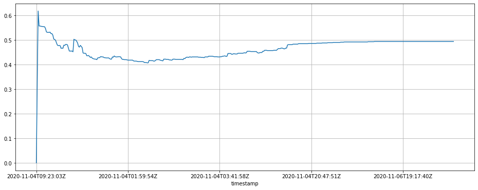

<!-- generated by epythet -->

# elections

A unified Python interface to multiple election data sources from around the world.

## Overview

The `elections` package provides easy access to various election data APIs through a consistent interface. Whether you need U.S. federal campaign finance data, international parliamentary statistics, or real-time election results, this package offers a simple way to access it all.

## Installation

```bash
pip install elections
```

Note: Some data sources require additional dependencies (pandas, py2store) which will be installed automatically.

## General Interface

The package provides a dictionary-like interface to access different data source modules:

```python
from elections import ElectionsDataModules

# Access all data source modules
modules = ElectionsDataModules()

# List available sources
print(list(modules))
# ['nytimes', 'openfec', 'google_civic', 'democracy_works', 'ipu_parline']
```

### Available Data Sources

- **nytimes**: New York Times election results (2016, 2020, 2024) - No API key required
- **openfec**: Federal Election Commission campaign finance data - Optional API key
- **google_civic**: Google Civic Information API (polling, representatives, voter info) - API key required
- **democracy_works**: Democracy Works election guidance (dates, deadlines, locations) - No API key required
- **ipu_parline**: Inter-Parliamentary Union global parliamentary data - No API key required

## Usage Examples

### OpenFEC - Federal Campaign Finance

Access U.S. federal campaign finance data, including candidates, committees, and contributions:

```python
from elections import ElectionsDataModules

modules = ElectionsDataModules()

# Get OpenFEC module
openfec = modules["openfec"]

# Get 2024 presidential candidates
candidates = openfec.get_candidates(year=2024, office="president")
print(f"Found {len(candidates['results'])} candidates")

# Search for specific candidate
results = openfec.search_candidates("Biden", year=2024)

# Get financial totals for a candidate
totals = openfec.get_candidate_totals("P80001571", year=2020)
```

**API Key:** Optional for higher rate limits. Get a free key at https://api.open.fec.gov/developers/

### Google Civic Information

Get voter information, polling locations, and representatives:

```python
from elections import ElectionsDataModules

modules = ElectionsDataModules()

# Get Google Civic module
civic = modules["google_civic"]

# Get voter information for an address
info = civic.get_voter_info(
    "1600 Pennsylvania Ave NW, Washington, DC", api_key="YOUR_KEY"
)

# Get representatives for an address
reps = civic.get_representatives("340 Main St, Venice, CA 90291", api_key="YOUR_KEY")

# Get list of available elections
elections = civic.get_elections(api_key="YOUR_KEY")
```

**API Key:** Required. Get a free key at https://console.developers.google.com/

### IPU Parline - International Parliamentary Data

Access global parliamentary and election data for 190+ countries:

```python
from elections import ElectionsDataModules

modules = ElectionsDataModules()

# Get IPU Parline module
ipu = modules["ipu_parline"]

# Get parliament information for France
france = ipu.get_parliament("FRA")

# Get election results for Germany
results = ipu.get_election_results("DEU")

# Get women in parliament statistics
stats = ipu.get_women_in_parliament("SWE")

# Get list of all countries
countries = ipu.get_country_list()
```

**API Key:** Not required

### Democracy Works

Get U.S. election dates, deadlines, and voting locations:

```python
from elections import ElectionsDataModules

modules = ElectionsDataModules()

# Get Democracy Works module
dw = modules["democracy_works"]

# Get upcoming elections
upcoming = dw.get_upcoming_elections(region="PA", days_ahead=60)

# Get elections for a specific state
state_elections = dw.get_state_elections("CA")

# Get all elections
elections = dw.get_elections()
```

**API Key:** Not required

### New York Times Election Results

Access historical U.S. election results (2016, 2020, 2024):

```python
from elections import ElectionsDataModules

modules = ElectionsDataModules()

# Get NYT module
nyt = modules["nytimes"]

# Get election data for a state
data = nyt.get_election_data("florida", year=2020)

# Get all races for a state
races = nyt.get_races("pennsylvania", year=2020)

# Get president race time series
timeseries = nyt.get_president_timeseries("georgia", year=2020)
```

**API Key:** Not required

## Direct Module Import

You can also import data source modules directly:

```python
# Import specific modules
from elections import openfec, google_civic, ipu_parline

# Use them directly
candidates = openfec.get_candidates(year=2024, office="president")
info = google_civic.get_voter_info("1600 Pennsylvania Ave", api_key="YOUR_KEY")
france = ipu_parline.get_parliament("FRA")
```

## Consistent Parameter Names

Across all modules, we use consistent parameter names:

- **year**: Election year (e.g., 2020, 2024)
- **region**: Geographic region (state abbreviation like ‘PA’, or state name)
- **api_key**: API authentication key (when required)
- **race_type**: Type of race (e.g., ‘president’, ‘senate’, ‘house’)
- **office**: Office being sought (used by some APIs)

## API Keys Setup

Set API keys via environment variables for convenience:

```bash
export OPENFEC_API_KEY='your_openfec_key'
export GOOGLE_CIVIC_API_KEY='your_google_key'
```

---

# Specific Example: 2020 US elections

Easy access to (US 2020) election statistics.

Yes, you can do it via our general interface, doing:

```python
from elections import ElectionsDataModules

modules = ElectionsDataModules()

nyt = modules["nytimes"]
data = nyt.get_election_data("florida", year=2020)
```

But here’s another convenient dict-like interface that was made based on it.

```python
import pandas as pd
from elections import President2020TimeSeries, Races2020, Election2020RawJson
```

## President’s race stats

```python
from elections import President2020TimeSeries

s = President2020TimeSeries()
len(s)
# Returns: 51
```

`s` is a dictionary-like interface to the presidential race. Its keys are the states:

```python
print(*s)
# alabama alaska arizona arkansas california colorado connecticut delaware
# district-of-columbia florida georgia hawaii idaho illinois indiana iowa kansas
# kentucky louisiana maine maryland massachusetts michigan minnesota mississippi
# missouri montana nebraska nevada new-hampshire new-jersey new-mexico new-york
# north-carolina north-dakota ohio oklahoma oregon pennsylvania rhode-island
# south-carolina south-dakota tennessee texas utah vermont virginia washington
# west-virginia wisconsin wyoming
```

Its values are dataframes containing the stats:

```python
state = "georgia"
df = s[state]
df
```

| timestamp            | votes   | eevp   | eevp_source   | trumpd   | bidenj   |
|----------------------|---------|--------|---------------|----------|----------|
| 2020-11-04T09:23:03Z | 0       | 0      | edison        | 0.000    | 0.000    |
| 2020-11-04T00:14:11Z | 408     | 0      | edison        | 0.674    | 0.326    |
| 2020-11-04T00:15:51Z | 127106  | 2      | edison        | 0.370    | 0.618    |
| 2020-11-04T00:19:55Z | 173638  | 3      | edison        | 0.431    | 0.557    |
| …                    | …       | …      | …             | …        | …        |
| 2020-11-06T23:45:40Z | 4970093 | 99     | edison        | 0.493    | 0.494    |

*456 rows × 5 columns*

```python
df["bidenj"].plot(figsize=(16, 6), grid=True, title=state)
```



## Other races

But that’s not the only race going on here.

```python
from elections import Races2020

s = Races2020()
len(s)
# Returns: 51
```

```python
data = s["new-york"]  # by the way, you can tab-complete this in a jupyter notebook
print(type(data))
# <class 'py2store.base.Store'>

print(f"{len(data)} items... Here are the first 5:")
list(data)[:5]
# ['president-general-2020-11-03',
#  'house-general-district-001-2020-11-03',
#  'house-general-district-002-2020-11-03',
#  'house-general-district-003-2020-11-03',
#  'house-general-district-004-2020-11-03']
```

So we see that now, instead of just getting the president’s race, we get… 242 races (one of which is the president’s race).

What you need to know is that `President2020TimeSeries` just gave you one of the many data fields available for the race (the ‘timeseries’ one), extracted and formatted for your convenience, since it’s probably the main information you’re here for.

But there are other associated (raw) data fields you may or may not be interested in. Here’s what you got:

```python
data[
    "president-general-2020-11-03"
].keys()  # you can tab complete here as well (you're welcome!)
# dict_keys(['race_id', 'race_slug', 'url', 'state_page_url', 'ap_polls_page',
#            'edison_exit_polls_page', 'race_type', 'election_type', 'election_date',
#            'runoff', 'race_name', 'office', 'officeid', 'race_rating', 'seat',
#            'seat_name', 'state_id', 'state_slug', 'state_name', 'state_nyt_abbrev',
#            'state_shape', 'party_id', 'uncontested', 'report', 'result',
#            'result_source', 'gain', 'lost_seat', 'votes', 'electoral_votes',
#            'absentee_votes', 'absentee_counties', 'absentee_count_progress',
#            'absentee_outstanding', 'absentee_max_ballots', 'provisional_outstanding',
#            'provisional_count_progress', 'poll_display', 'poll_countdown_display',
#            'poll_waiting_display', 'poll_time', 'poll_time_short', 'precincts_reporting',
#            'precincts_total', 'reporting_display', 'reporting_value', 'eevp',
#            'tot_exp_vote', 'eevp_source', 'eevp_value', 'eevp_display',
#            'county_data_source', 'incumbent_party', 'no_forecast', 'last_updated',
#            'candidates', 'has_incumbent', 'leader_margin_value', 'leader_margin_votes',
#            'leader_margin_display', 'leader_margin_name_display', 'leader_party_id',
#            'counties', 'votes2016', 'margin2016', 'clinton2016', 'trump2016',
#            'votes2012', 'margin2012', 'expectations_text', 'expectations_text_short',
#            'absentee_ballot_deadline', 'absentee_postmark_deadline', 'update_sentences',
#            'race_diff', 'winnerCalledTimestamp', 'timeseries'])
```

```python
t = data["president-general-2020-11-03"]
print(t["trump2016"], t["clinton2016"])
# 2819534 4556124
```

## Election2020RawJson

But if you want even more raw data than the above, we can give that to you.

With `Election2020RawJson` you get access to the original full JSON.

```python
from elections import Election2020RawJson
import pandas as pd

raw_jsons = Election2020RawJson()
json_data = raw_jsons["california"]

print(json_data.keys())
# dict_keys(['data', 'meta'])

print(json_data["meta"])
# {'version': 10403,
#  'track': '2020-11-03',
#  'timestamp': '2020-11-06T23:52:57.623Z'}

print(json_data["data"].keys())
# dict_keys(['races', 'party_control', 'liveUpdates'])
```

### Party Control

```python
party_df = pd.DataFrame(json_data["data"]["party_control"]).set_index("race_type").T
```

| race_type          | house   | president   | senate                                         |
|--------------------|---------|-------------|------------------------------------------------|
| needed_for_control | 218     | 270         | 50                                             |
| total              | 435     | 538         | 100                                            |
| no_election        | {}      | {}          | {‘democrat’: 35, ‘republican’: 30, ‘other’: 0} |

### Live Updates

```python
updates_df = pd.DataFrame(json_data["data"]["liveUpdates"])
print(f"Total live updates: {len(updates_df)}")
# Total live updates: 449
```

Example entries from the 449 live updates:

|   id | author          | location        | text                                                |
|------|-----------------|-----------------|-----------------------------------------------------|
|  333 | Nate Cohn       | in New York     | New ballots from Clark County (that’s Las Vegas)…   |
|  332 | Nate Cohn       | in New York     | The latest Arizona ballot releases aren’t looking…  |
|  331 | Nick Corasaniti | in Philadelphia | There are still 102,000 mail ballots to be counted… |
|  330 | Dave Philipps   | in Las Vegas    | Biden nets 2,520 votes in the Las Vegas area…       |
<p class="epythet-aggregates">This documentation as a single file: <a href="elections.md">elections.md</a> (Markdown, for agents).</p>
